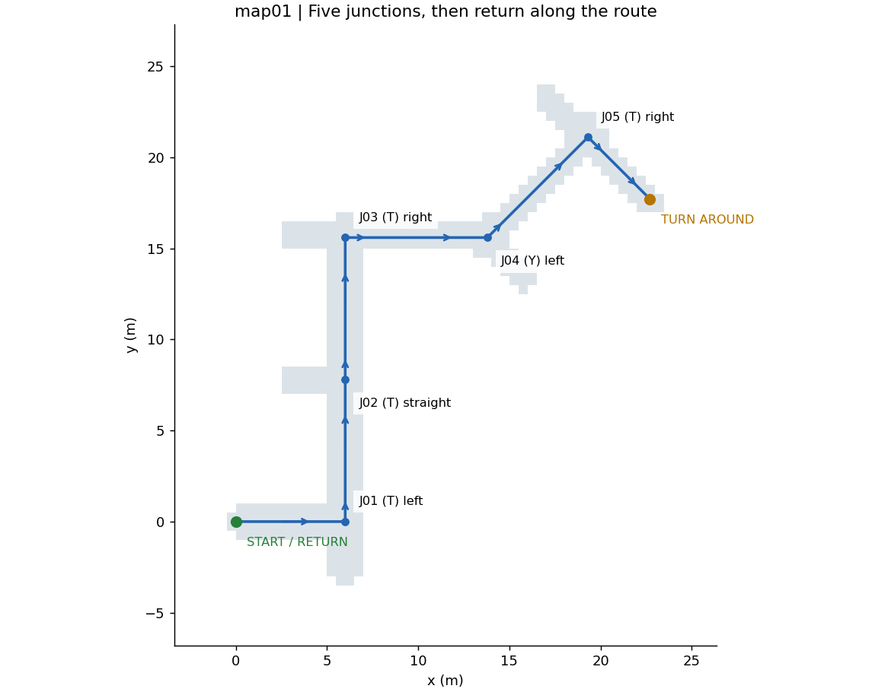
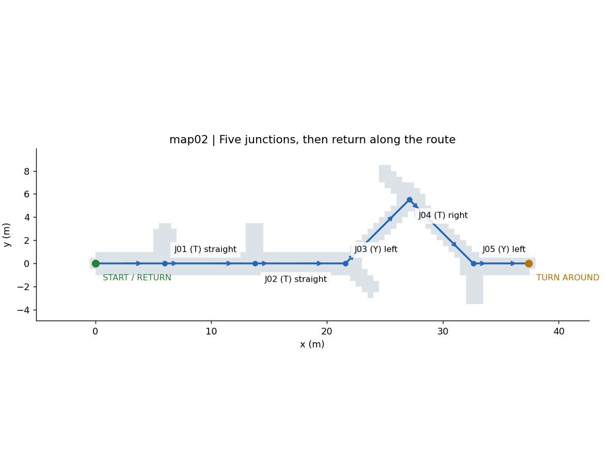
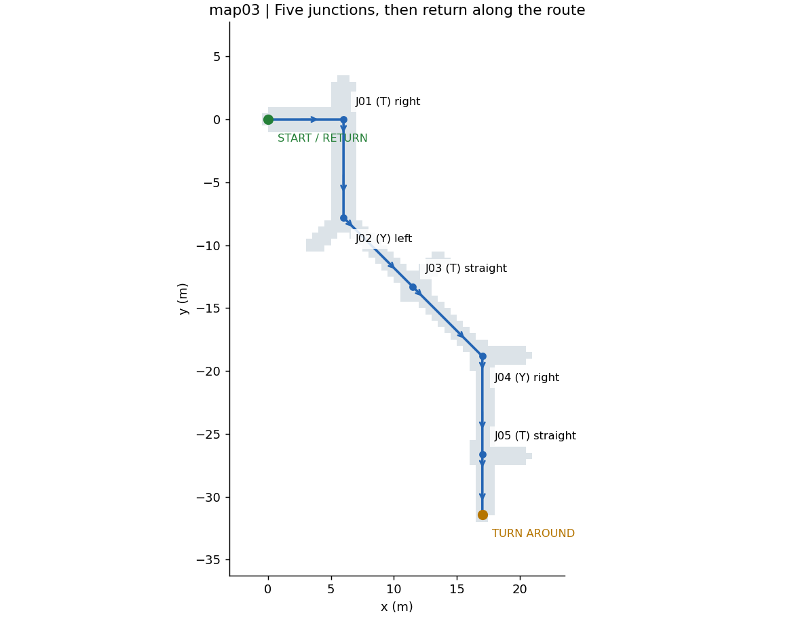
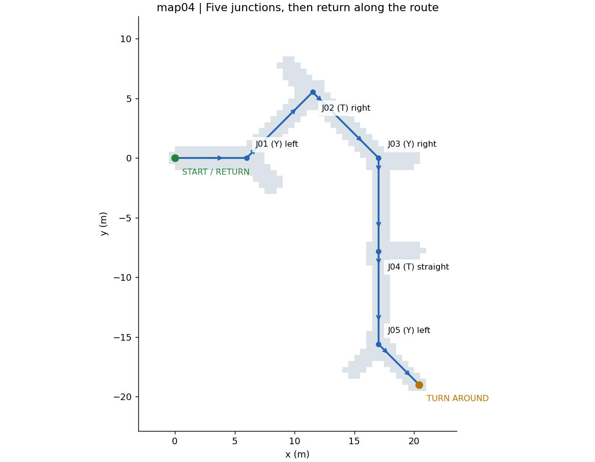
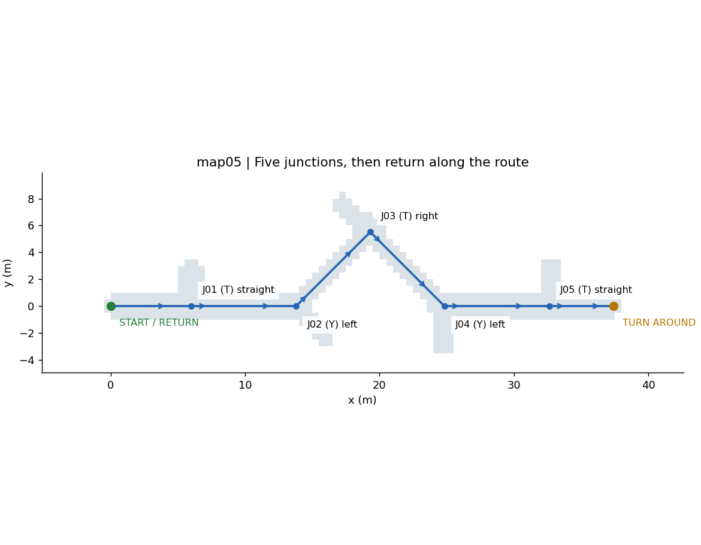

# 巡渊 S10 测评工具

选手提交两个完整项目：一个控制机器人走路线，一个识别视频里的数字和温度。每个项目都带运行代码、权重、依赖和 `AGENT.md`。测评程序启动选手代码，在仿真和视频中运行，自动生成成绩。

当前版本：**v0.3.0**。

## 1. 分数怎么算

| 项目 | 分值 | 怎么测 |
|---|---:|---|
| 导航和运控 | 50 | 路线 30 分、推力 10 分、低摩擦地面 10 分 |
| 视频识别 | 20 | 识别数字牌和温度屏 |
| 报告 | 30 | 评委评分后填入总成绩 |

推力按 **60 → 40 → 20 → 5 N** 测试，每次侧推持续 **0.5 秒**。每档单独从起点开始，高档失败后继续测低档。摩擦从最滑的地面开始测：**0.1 → 0.2 → 0.4 → 0.8**。

60 N 最高档来自本机训练模型的重复实测：以 0.4 米/秒前进，左右各三个施力时机；40 N 六次通过，60 N 六次失败。详细结果见[扰动实测](docs/disturbance-validation.md)，具体扣分见[评分规则](docs/rules.md)。

## 2. 地图长什么样

每张图有五个 T/Y 路口，走到终点后掉头，沿规定路线返回。绿色是起点，橙色是掉头位置，蓝线是规定路线。

| 地图 1 | 地图 2 | 地图 3 |
|---|---|---|
|  |  |  |
| 地图 4 | 地图 5 | |
|  |  | |

| 地图 | 去程五个路口 | 任务文件 |
|---|---|---|
| 1 | 左、直、右、左、右 | [map01.json](challenges/v3/tasks/map01.json) |
| 2 | 直、直、左、右、左 | [map02.json](challenges/v3/tasks/map02.json) |
| 3 | 右、左、直、右、直 | [map03.json](challenges/v3/tasks/map03.json) |
| 4 | 左、右、右、直、左 | [map04.json](challenges/v3/tasks/map04.json) |
| 5 | 直、左、右、左、直 | [map05.json](challenges/v3/tasks/map05.json) |

模型通过前置画面或雷达发现路口，再执行提前给好的方向。清单中填写自己使用的传感器：纯视觉、纯雷达或两者融合。成绩文件会保留这项配置。

## 3. 选手提交什么

```text
my_team/
  submission.json
  navigation/
    AGENT.md
    run.py
    requirements.txt
    weights/
  recognition/
    AGENT.md
    run.py
    requirements.txt
    weights/
  report.pdf
```

权重可以是 `.pt`、`.pth`、ONNX 或其他格式。选手的代码负责加载权重和完成推理。两个项目都按[运行接口](docs/model-interface.md)接收输入、返回结果。

每个 `AGENT.md` 写清安装方法、权重位置、运行命令、输入输出和检查方法。组织方的 Agent 按说明安装并运行项目。完整步骤见[提交说明](docs/submission.md)和[Agent 复现步骤](docs/agent-evaluation.md)。

## 4. 先试一下安装和接口

使用 Python 3.11，在仓库根目录执行：

```bash
git clone https://github.com/LWS30/xunyuan-evaluation.git
cd xunyuan-evaluation
python -m pip install -e ".[runtime]"
python -m tools.make_project_example --output artifacts/example_team
python -m xunyuan_eval check-submission \
  --submission artifacts/example_team/submission.json --smoke
MUJOCO_GL=egl python -m xunyuan_eval run-submission \
  --submission artifacts/example_team/submission.json \
  --route map01 --max-seconds 3 --output results/first_run
```

生成的两个示例项目可以直接运行：导航输出零动作，识别输出空结果，用来检查安装、进程通信和仿真记录。加 `--format pt` 可以生成使用 PyTorch 权重的示例，需要先安装 PyTorch。

## 5. 选手怎么给自己打分

按[下载说明](docs/datasets.md)把视频放进 `datasets/video_v3/`。准备好自己的两个项目后运行：

```bash
python -m xunyuan_eval check-submission --submission my_team/submission.json --smoke
MUJOCO_GL=egl python -m xunyuan_eval run-submission \
  --submission my_team/submission.json --videos datasets/video_v3 \
  --split train --output results/my_test01
```

程序会跑五张图、四档推力、四档地面摩擦，再读取八段训练视频。打开 `results/my_test01/report.json` 看路线 30、推力 10、摩擦 10、识别 20，以及合计的 **70 分练习成绩**。

实际位置、姿态和碰撞由 MuJoCo 记录。成绩里列出每次失败的原因，训练识别结果还列出正确答案。修改模型后，换一个输出目录再测，例如 `results/my_test02`。

只检查识别模型时，也可以[单独运行一段训练视频](docs/datasets.md)。视频从清晰大字开始，逐步增加模糊、噪声和遮挡，每段仍为十分钟。

## 6. 我们怎么正式测评

组织方 Agent 按两个 `AGENT.md` 准备依赖，先运行检查，再使用同一批地图和种子评测所有队伍：

```bash
MUJOCO_GL=egl python -m xunyuan_eval run-submission \
  --submission team/submission.json --videos datasets/video_v3 \
  --split test --video-reference organizer/video_test_reference.json \
  --seed 20261126 --output results/team01
```

测试视频共两段，答案由组织方保存。自动分满分 70。评委给报告打分后，例如 27 分：

```bash
python -m xunyuan_eval add-report-score \
  --report results/team01/report.json --score 27 \
  --output results/team01/final_report.json
```

`final_score` 就是满分 100 的最终成绩。选手使用以下命令打包完整代码和权重：

```bash
python -m xunyuan_eval package-models \
  --submission my_team/submission.json --output artifacts/team_submission.zip
```

## 7. 文件和检查命令

```text
challenges/v3/      五张赛道、机器人、路线、传感器和评分参数
xunyuan_eval/       项目运行、观测采集、记录和评分
datasets/video_v3/  视频清单、训练答案和下载说明
tools/             生成地图、视频、示例和扰动实测工具
tests/             自动测试
docs/              提交、接口、评分和复现说明
```

```bash
python -m unittest discover -s tests -v
python -m tools.check_v3_physics --output results/physics_check.json
python -m xunyuan_eval demo-v3 --output artifacts/scoring_example
python -m xunyuan_eval score-challenge \
  --run artifacts/scoring_example/run.json \
  --reference artifacts/scoring_example/reference.json \
  --video-reference artifacts/scoring_example/video_reference.json \
  --output artifacts/scoring_example/report.json
```

最后这组生成记录用于查看打分格式，预期自动分为 70。
