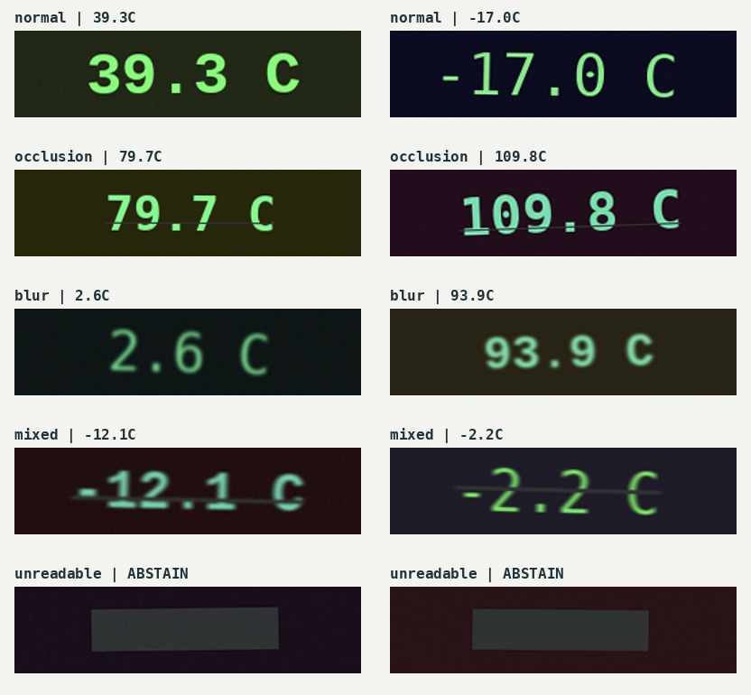

# 温度图片数据集 V3

这里有 15,000 条温度样本。每条提供两张 PNG 图片：一张完整面板，一张只保留数字区域的裁剪图，并配有正确读数。

图片由程序绘制。温度范围为 −20.0 至 120.0 ℃，保留一位小数。

| 用途 | 样本数 | 图片数 |
|---|---:|---:|
| 训练 `train` | 12,000 | 24,000 |
| 调整模型 `val` | 1,500 | 3,000 |
| 检查效果 `test` | 1,500 | 3,000 |
| 合计 | 15,000 | 30,000 |

图片有清晰、部分遮挡、模糊、遮挡加模糊、完全看不清五种情况。同一个温度值的所有图片都放在同一组里，方便分别训练和检查效果。

看不清的图片，答案中的 `value` 和 `text` 是 `null`，识别结果应说明看不清的原因。

仓库里有全部标注、预览图和 `sample/` 下的 30 条样例、60 张图片。完整图片在 [Release 下载页](https://github.com/LWS30/xunyuan-evaluation/releases/tag/v0.1.1) 的 `xunyuan-temperature-v3.zip` 中。

下载和评分步骤见[图片使用说明](../../docs/datasets.md)。

